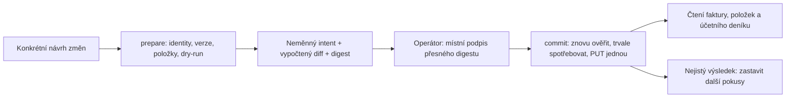

# Řízené opravy existujících přijatých faktur (0.4)

Čtecí nástroje fungují stejně jako dosud. Zápisy do existujících přijatých faktur
se zapínají explicitně pro konkrétní cíl a konkrétní pole. Nevystavuje se obecné
PUT/POST rozhraní, vytváření/mazání dokladů, placení ani podávání daňových tvrzení.

## Postup



`flexi_invoice_update_prepare` vyžaduje `target`, přesné číselné `invoiceId`,
očekávané číslo dokladu `expectedCode`, změny hlavičky a/nebo přesně určených
existujících položek. Kontroluje příslušnost položek, lokální allowlist a aktuální
schéma. Neexistující či cizí položka nesmí být implicitně založena.

Prepare provede dokumentovaný `dry-run=true`; fakturu neuloží. Náhled obsahuje
původní hodnoty, požadované změny i normalizovaný vypočtený výsledek obchodní
logiky. Intent má vlastní digest, expiraci a vazbu na cílový server, databázi,
credential profil a politiku. Schválení nezahrnuje jiné budoucí změny.

Samostatný endpoint „přegenerovat zaúčtování faktury“ nebyl doložen. Změna probíhá
uložením zdrojového dokladu/položek přes obchodní logiku Flexi a následnou kontrolou
skutečného účetního deníku. `regenerateAccounting:true` proto znamená požadavek
na ověření konkrétních `accountingExpectation.rows`, nikoli volání plošné akce.
Očekávané řádky musí zahrnovat účty MD/DAL, částku, příznak DPH, členění DPH a
stav zaúčtování. Bez ověřené postcondition se nehlásí úspěšné přeúčtování.

## Konfigurace

V konfiguračním JSON zvolte `readOnly:false` a přidejte veřejný schvalovací klíč
a úložiště intentů. Každá zapisovatelná firma potřebuje vlastní `writePolicy`.
Klíče níže jsou příklad struktury, nikoli obecné povolení všech zápisů:

```json
{
  "readOnly": false,
  "write": {
    "storePath": "write-intents",
    "approvalPublicKeyPath": "operator/public.pem"
  }
}
```

```json
{
  "writePolicy": {
    "enabled": true,
    "headerFields": ["clenDph", "clenKonVykDph"],
    "itemFields": ["clenDph", "clenKonVykDph"]
  }
}
```

Cesty jsou relativní ke konfiguračnímu souboru. Zapisovatelný cíl vyžaduje
runtime-schema režim `allowedEvidences:["*"]`. Zapnutý writer přidává tři nástroje
prepare/status/commit; vícefiremní instalace potom nabízí celkem 16 nástrojů.
`server_info` hlásí schopnosti konkrétního cíle v `invoiceUpdates`.

## Místní schválení

Jednorázové vytvoření místních klíčů nekomunikuje s Flexi:

```sh
node scripts/setup-write-approval.mjs --directory=.state/operator
```

Privátní klíč se nepředává MCP procesu. Schválení provede operátor ručně
v terminálu podle ID a digestu vráceného prepare:

```sh
npm run write:approve -- --store=.state/write-intents --key=.state/operator/private.pem --intent=UUID --digest=SHA256
```

CLI ukáže přesnou firmu, doklad a náhled. Vyžaduje terminál a opsání
`SCHVALUJI <digest>`. Pouze podepíše intent; neukládá fakturu. Následný MCP commit
přijme pouze `target` a `intentId`, nikoli nový payload nebo `approved:true`.
Agent nesmí schvalovací CLI spouštět sám.

Tento místní podpis odděluje schválení od MCP nástrojů a chrání před změnou
schváleného payloadu. Je provozní bariérou pro důvěryhodný host. Agent nebo člověk
s neomezeným shellem pod stejným OS účtem může mít přístup i k privátnímu klíči;
pro nezávislou bezpečnostní hranici je potřeba oddělený signer/uživatelská identita
nebo klíč vyžadující fyzickou přítomnost. Samotná lokální CLI tuto vlastnost neslibuje.

## Konflikty, pád procesu a nejasné výsledky

Před skutečným PUT se kontroluje čerstvý snapshot, platnost schválení a expirace.
Flexi navíc dostává přesné `lastUpdate` s `as-gui=true` a režimem `@create:fail`,
`@update:ok`. Všechny existující položky jsou chráněné verzí; nelze tak potichu
přepsat jinou souběžně upravenou položku. Zamčené/stornované doklady se automaticky
neodemykají a varování nejsou ignorovaná.

Stav `committing` se synchronizuje na disk před síťovým zápisem. Timeout,
nejednoznačná odpověď, neúspěšný readback nebo pád v této fázi znamenají `unknown`.
`flexi_invoice_update_status` čte lokální stav i při výpadku API. Neznámý výsledek
se neopakuje automaticky; ochrana dokumentu blokuje i nový intent stejné faktury,
dokud není výsledek operátorem vyřešený. Locky/fence se nesmějí odstraňovat naslepo.

Úspěch znamená ověřený uložený doklad, položky a požadované účetní řádky, nikoli
jen HTTP 200. Přehled ověřených upstream pravidel a zdrojů je v
[invoice-write-contract.md](research/invoice-write-contract.md).
