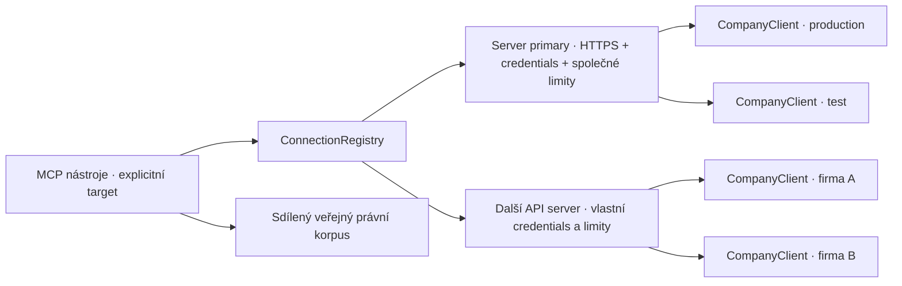

# Více API serverů a více firem v jednom MCP

Stav: implementováno ve verzi 0.3. Zůstává zachován čtecí provoz nad ostrými daty.
Následující rozhodnutí popisují implementovaný refaktor; hromadný endpoint je případný další krok.

Živé discovery 2026-10-26 ověřilo jednu přístupnou produkční firmu ve stavu
`ESTABLISHED`. Další zakládaná testovací firma se při poslední kontrole ještě
nevrátila. Její skutečné `dbNazev` ani dostupnost tímto účtem zatím nejsou
ověřené; ukázky používají zástupné servery a databázové názvy.

## Cíl a základní rozhodnutí

Jeden MCP proces může obsluhovat několik pevně nakonfigurovaných HTTPS serverů.
Každý server má vlastní přihlášení a několik firem. Každé datové volání určuje
jednoznačný cíl `target`, například `primary/production` nebo
`primary/test`. Výběr cíle nemění globální stav procesu.

Nezavádět `set_active_company`, sdílenou proměnnou aktuální firmy ani přepisování
prostředí při volání. Dvě konverzace mohou současně pracovat s různými firmami.
Neznámý nebo neúplný cíl skončí chybou; požadavek se nikdy nepřesměruje do výchozí
nebo první dostupné firmy.



## Identifikátory

| Hodnota | Význam | Příklad |
|---|---|---|
| `serverId` | Lokální stabilní identifikátor serveru | `primary` |
| `companyId` | Lokální stabilní identifikátor firmy v konfiguraci | `production`, `test` |
| `target` | Jednoznačný klíč server + firma pro MCP volání | `primary/test` |
| `database` | Skutečné `dbNazev` vrácené Flexi, používané v `/c/{database}` | `example_company` |
| `name` | Zobrazovaný název z Flexi; není routingový klíč | `Ukázková firma s.r.o.` |
| `environment` | Provozní označení v konfiguraci a výsledcích | `production`, `test` |

Stejné `companyId` i `database` může existovat na dvou serverech. Číslo dokladu,
interní ID záznamu, název firmy ani IČO samostatně neurčují cíl API volání.
Při obnově zálohy může Flexi změnit `dbNazev`; přemapování vyžaduje explicitní
úpravu konfigurace, nikoli automatické hledání podobného názvu.

## Konfigurace a přístupová politika

`FLEXI_CONFIG_PATH` ukazuje na lokální JSON konfiguraci. Příklad struktury
je v [connections.example.json](../config/connections.example.json).
Soubor obsahuje originy, firemní mapování, politiky a názvy proměnných prostředí;
hesla se nenačítají z argumentů MCP ani z dotazů modelu. Loader při startu vyřeší
odkazy na secrets a nikde je nevypisuje.

Ukázkový soubor není aktivní konfigurace: obsahuje zástupné databázové názvy
a druhý server je smyšlený. Verze 0.3 vyžaduje `readOnly: true`; od verze 0.4 lze
samostatně povolit [podepisované opravy přijatých faktur](invoice-updates.md)
pomocí `readOnly:false` a explicitní firemní `writePolicy`.
Serverová i firemní ID mají pevný formát bez `/`; `target` vzniká jen jako
spojení dvou validovaných ID.

Každý server obsahuje pojmenované credential profily. Firma odkazuje na profil,
což umožní použít jednoho API uživatele pro více firem nebo odlišné uživatele na
stejném serveru. Profil je svázaný s jedním přesným originem; nelze jej přenést
na URL dodanou nástrojem.

Výchozí politika je explicitní seznam firem. Nově objevená firma se zobrazí při
discovery, ale nezíská automaticky datový přístup v MCP. Effective access je
průnik nakonfigurovaných firem, přístupnosti firmy pro daný credential profil,
jejího provozního stavu a oprávnění na evidence/pole. Firma ve stavu vytváření
je viditelná jako nepřipravená a datové operace vracejí `COMPANY_NOT_READY`.

`environment: test` je označení cíle; samo o sobě nepovoluje mutace. Čtecí
nástroje zůstávají pouze pro čtení; zápisy mají samostatnou politiku a podpis.
Není potřeba přidávat databázi ani
HTTP server jen kvůli několika lokálně nakonfigurovaným firmám.

## Rozhraní MCP

| Nástroj | Navržené argumenty / chování |
|---|---|
| `server_info` | Bez cíle: verze, globální limity a registrované servery. S `target`: schopnosti konkrétní firmy. Bez tajných údajů. |
| `flexi_server_list` | Seznam nakonfigurovaných serverů a jejich veřejných stavů. |
| `flexi_company_list` | `{serverId, credentialId?}`; živé stránkované `/c.json`, názvy, přesné `dbNazev`, stav, dostupnost a příznak, zda existuje povolený `target`. Při více profilech je profil povinný. |
| `flexi_target_list` | Seznam nakonfigurovaných cílů, jejich prostředí a posledního ověřeného stavu. Přístupnost může být `unknown`, dokud neproběhne živé ověření. |
| `flexi_evidence_list` | `{target, query?}` |
| `flexi_schema_get` | `{target, evidence}` |
| `flexi_relations_get` | `{target, evidence}` |
| `flexi_record_list` | `{target, evidence, fields, pageSize, filters, cursor?}` |
| `flexi_record_get` | `{target, evidence, id, fields}` |
| `flexi_relation_list` | `{target, evidence, id, relation, fields, pageSize, filters, cursor?}` |
| `czlaw_*` | Veřejný korpus zůstává sdílený a neobsahuje firemní data. |

Například dva nezávislé požadavky, které může host spustit současně:

```json
{"target":"primary/production","evidence":"faktura-prijata","fields":["id","kod","nazFirmy"],"pageSize":1}
```

```json
{"target":"primary/test","evidence":"faktura-prijata","fields":["id","kod","nazFirmy"],"pageSize":1}
```

Každý firemní výsledek včetně chyb obsahuje metadata `target`, `serverId`,
`companyId`, skutečné `database`, zobrazovaný název a `environment`. Pro odmítnutý
neznámý cíl se nevymýšlí metadata jiné firmy. Discovery výsledky mají serverový
rozsah; právní a jiné globální výsledky globální rozsah.

Pro práci s více firmami současně není nutný jeden hromadný endpoint. Host může
volat běžné nástroje paralelně s různými cíli. Případný pozdější
`flexi_record_list_many` přijme omezený seznam samostatných dotazů a vrátí
výsledky odděleně podle cíle. Nebude slučovat doklady do neoznačeného seznamu,
slibovat transakční snapshot ani skrývat částečná selhání.

Registrovat jednu společnou sadu nástrojů, ne další kopii nástrojů pro každou
firmu. Formát argumentů je společný, ale konkrétní evidence a field policy se
ověřují až podle zvoleného cíle. Smíšený provoz omezených i `*` profilů tak
nepřevezme schopnosti prvního klienta v registru.

## Vnitřní refaktor

| Soubor / komponenta | Změna |
|---|---|
| `src/config.ts` | Validovat `servers[]`, unikátní ID, credential odkazy a firemní politiky; normalizovat legacy konfiguraci do stejného modelu. |
| nový `src/connections.ts` | `ConnectionRegistry`, lookup cíle, ověřování dostupnosti/stavu firmy, lazy vytváření klientů. Neměnný routing. |
| nový `src/flexi/transport.ts` | HTTPS transport vázaný na server a credential profil, stávající TLS/redirect/timeout/size ochrany a společné limity. Nedovolí libovolné URL z MCP vstupu. |
| `src/flexi/client.ts` | Zachovat firemní klient vázaný na jednu neměnnou `database`; transport injektovat. Stávající čtecí metody a parsování zůstanou znovupoužitelné. |
| `src/server.ts` | Místo singletonu `dependencies.flexi` vyhledat klienta přes `registry.resolve(target)` uvnitř každého volání. Audit, výsledky a resources dostanou explicitní rozsah. |
| `src/cursor.ts` | Rozšířit binding o přesný cíl a revizi routingu/politiky. |
| `src/audit.ts` | Přidat serverový/firemní kontext bez hesel a obsahu dokladů. Zachovat validaci starých auditních řetězců. |
| `src/index.ts`, launcher | Načíst registr při startu, zachovat jeden audit na proces a řízené ukončení. Žádný runtime přepis `process.env` podle aktuálního požadavku. |
| `test/`, smoke skripty | Pokrýt více serverů, firem, credential profilů a současná volání. |

## Izolace, limity a chyby

Cache schémat, evidencí a vazeb musí být oddělená nejméně podle serveru,
credential profilu, databáze a revize politiky. Nejjednodušší je zachovat vlastní
cache v každém firemním klientovi a klienty nikdy nesdílet mezi cíli. Reuse aliasu
po změně routingu nesmí zpřístupnit starou cache.

Cursor se váže na cílovou firmu, revizi routingu, credential/policy profil,
evidenci, rodičovský záznam/relaci, vybraná pole, filtry a velikost stránky.
Cursor firmy A se musí odmítnout ve firmě B i při stejném ID dokladu a stejném
dotazu. Restart nadále zneplatní process-local cursory.

Limity nesmějí vzniknout jen násobením počtu firem: sdílet omezení souběhu a
lokální rozpočet na serveru; zachovat i globální limit MCP a případně nižší limit
na firmu. Licenční rozpočet se musí vztahovat ke skutečnému licenčnímu rozsahu
Flexi, ne předpokládat, že každá firma má vlastní nezávislou kvótu. Neznámý rozsah
konzervativně sdílí rozpočet serveru. Neomezená fronta požadavků se nezavádí.

Výpadek jednoho API serveru nevypne zbývající registry ani právní korpus.
Chyba nese kontext původně zvoleného cíle a nevyvolá fallback na jiný server,
jiné přihlášení ani jinou firmu. Selhání auditu nadále blokuje výsledky.

Jde o agregaci firem pod jedním lokálním MCP hostem a jeho oprávněným operátorem.
Sama o sobě nenahrazuje autentizaci jednotlivých lidí ani tenantové ACL potřebné
pro budoucí vzdálený server používaný různými zákazníky.

## Migrace současné instalace

1. Bez `FLEXI_CONFIG_PATH` převést dosavadní čtyři `FLEXI_*` údaje interně na jeden
   server a jeden cíl. Tím zachovat současné spuštění a testy. Staré volání bez
   `target` přijmout pouze při jediném nakonfigurovaném cíli.
2. Připravit novou konfiguraci se skutečným ověřeným originem a dvěma
   firmami. Databázový identifikátor Testovaci převzít až ze skutečného `/c.json`
   a počkat na připravenost firmy.
3. Nová konfigurace může odkazovat na stávající `FLEXI_USERNAME` a
   `FLEXI_PASSWORD`. Při aktivaci odstranit legacy routing proměnné
   `FLEXI_BASE_URL`, `FLEXI_COMPANY` a případné `FLEXI_CONNECTION_NAME`, aby nebyly
   dva zdroje pravdy. Loader má kombinaci dvou routing konfigurací odmítnout.
4. Nejprve ověřit kandidátní instanci s odděleným auditním souborem. Teprve po
   průchodu čtecích testů přepnout uložené spuštění; předchozí konfiguraci uchovat.
5. Jakmile je nakonfigurováno více cílů, chybějící `target` musí znamenat
   `TARGET_REQUIRED`. Pro testování neponechávat tichý produkční default.

Konfigurace je v první verzi neměnná po dobu procesu; změny vyžadují restart.
To zjednodušuje invalidaci klientů, cache a cursorů. Hot reload není podmínkou
podpory více firem.

## Ověření implementace před přepnutím

- Dva mock servery s odlišnými credentials, na každém dvě firmy se shodnými
  interními ID. Prokázat správné cíle i při prokládaných paralelních voláních.
- Odlišná schémata a přístupová práva mezi firmami; žádný přenos cache.
- Replay cursoru mezi firmami i servery, neznámý target, URL/path injection,
  nepovolená firma, změna routingu a auditní chyba musí být odmítnuté.
- Discovery musí správně rozlišit nepřipravenou firmu, nepřístupnou firmu,
  nepovolený cíl v MCP a nedostupný server. Bez žádného implicitního přesměrování.
- Globální/serverové limity sdílené mezi firmami; selhání jedné větve nesmí
  maskovat úspěch nebo chybový kontext druhé.
- V živém prostředí vylistovat firmy, načíst metadata a nejvýše jeden doklad
  pro každý povolený cíl. Prázdná Testovaci je platný výsledek. Nezakládat kvůli
  testu faktury, neimportovat záznamy a neprovádět zápisy.
- Druhý skutečný API server se označí za ověřený až po dodání jeho připojení;
  mock test není důkaz jeho živé dostupnosti.

Oficiální podklad pro discovery a provozní stavy firem:
[ABRA Flexi – Company identifier and list of companies](https://podpora.flexibee.eu/en/articles/4425606-company-identifier-company-id-and-list-of-created-companies-using-the-api).

## Implementační upřesnění 0.3

- Firemní `FlexiClient` zůstává samostatný; sdílený `OriginBudget` se injektuje
  přímo do HTTP operace. Slot drží až do ukončení čtení těla/omezeného cleanup,
  nikoli pouze do přijetí hlaviček.
- Krátká discovery cache je oddělená podle serveru a credential profilu.
  Generace požadavků zabrání opožděné staré odpovědi přepsat novější stav;
  zastaralý požadavek končí `DISCOVERY_CHANGED`. Explicitní refresh zneplatňuje
  starý snapshot. Kompletní seznam také označí zmizelé firmy jako nepřístupné. Discovery strop vrací
  `truncated`, interní úplné ověřování se při stropu zastaví chybou.
- `flexi_target_list` je stránkovaný. Cílené `server_info` neobsahuje ostatní cíle;
  globální výpis obsahuje nejvýše prvních 20 cílů a celkový počet.
- Konfigurace je neměnná do restartu. Žádný nástroj nemění origin, profil, firmu
  ani credentials. Od verze 0.4 existuje samostatný omezený postup pro opravu
  přijaté faktury s následným ověřením jejího zaúčtování.

Pravidla identity a přístupu byla ověřena vůči [dokumentaci firem ABRA](https://podpora.flexibee.eu/en/articles/4425606-company-identifier-company-id-and-list-of-created-companies-using-the-api)
a [správě API uživatelů](https://podpora.flexibee.eu/cs/articles/13617613-api-komunikace-jednoduse-pro-ne-it-uzivatele-co-to-je-a-jak-ho-nastavit-ve-flexi).
Veřejný právní korpus zůstává `not_ready`; nastavení firmy se neodvozuje z jejího
názvu ani z jiné účetní jednotky.

## Aktivní lokální instalace

Konfigurace je v `.state/connections.json` (gitignored), aktivovaný je přesně
ověřený produkční cíl. Původní secrets zůstávají v credential env
konfiguraci MCP; soubor obsahuje pouze odkazy na ně. Další target pro Testovaci
se doplní až podle skutečného discovery a přístupnosti API uživatele, nikoli podle
odhadu databázového jména. Původní routing má soukromou zálohu pro rollback.
